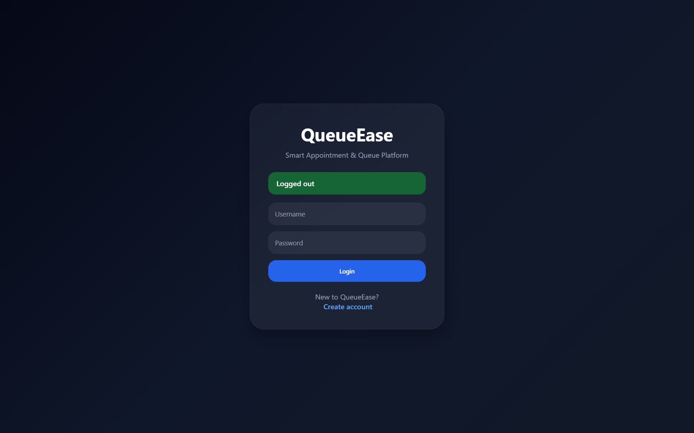
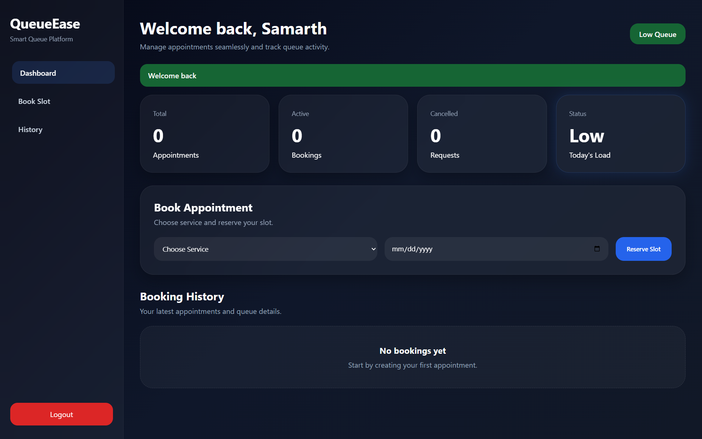

# QueueEase Pro

Smart Appointment & Queue Management Platform built using Flask and SQLite.

## Features

- User Authentication
- Appointment Booking
- Queue Token Generation
- Queue Position
- Estimated Wait Time
- Load Indicator
- Booking History
- Cancel Appointment
- Premium SaaS UI
- Responsive Dashboard

## Tech Stack

Backend:
- Python
- Flask
- SQLAlchemy
- SQLite

Frontend:
- HTML
- CSS
- Jinja

## Project Overview




## Project Structure

```text
QueueEase-Pro/
│
├── app.py
├── requirements.txt
├── .gitignore
├── README.md
│
├── templates/
│   ├── login.html
│   └── dashboard.html
│
└── static/
    └── style.css
```

## Installation

Clone:

```bash
git clone https://github.com/samoff04/QueueEase-Pro.git
```

Move into folder:

```bash
cd QueueEase-Pro
```

Install dependencies:

```bash
pip install -r requirements.txt
```

Run:

```bash
python app.py
```

Open:

```text
http://127.0.0.1:5000
```

## Problem Statement

People waste time waiting in queues without visibility.

QueueEase helps users:

- book appointments
- track queue position
- estimate waiting time
- manage bookings efficiently

## Future Improvements

- Admin Dashboard
- Notifications
- Email Alerts
- AI Queue Prediction
- Cloud Deployment
- Delete Account
- Forgot Password